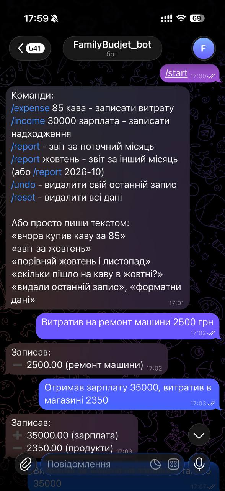
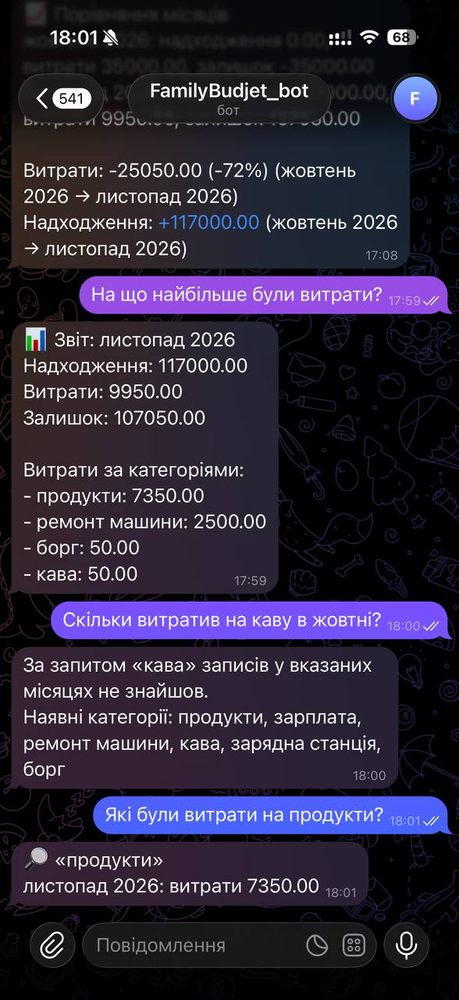
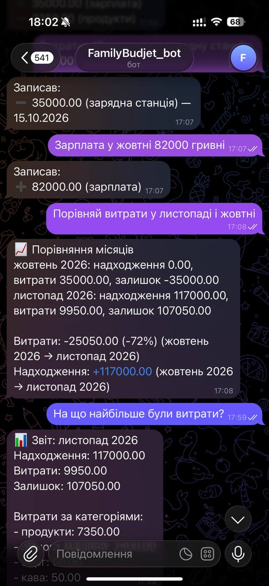
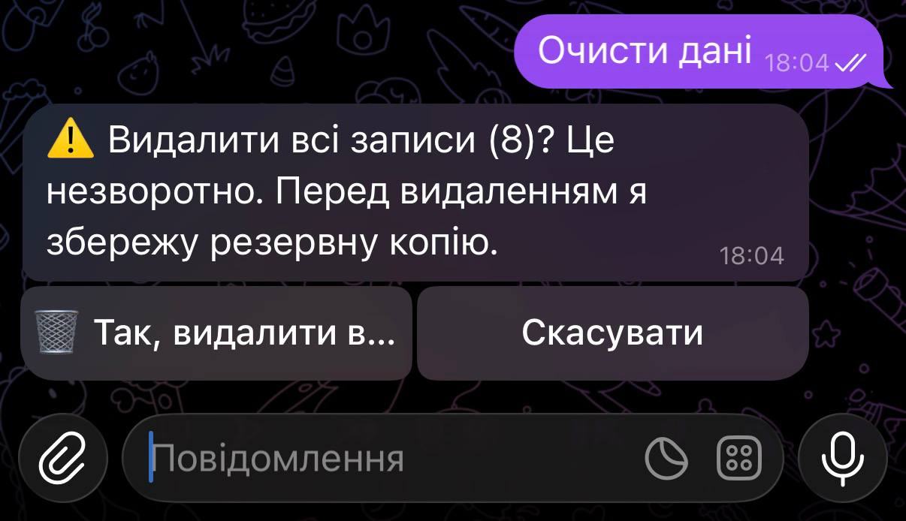
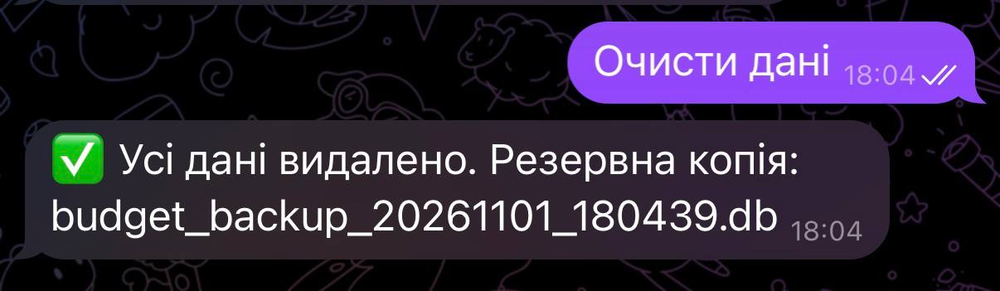

# Family Budget Bot

A Telegram bot for tracking a family budget in plain language. You write what you spent or earned, the bot understands it with an LLM, stores it in SQLite, and answers questions about your money.

> "yesterday coffee 85 and taxi 140, also got 2000 from a client"
> "compare October and November"
> "how much did we spend on coffee in October?"

The project is a small, complete example of integrating an LLM into a real system: chat interface, structured extraction, validation, storage, reporting and basic security.

## Features

- **Free-text entry.** Several expenses and incomes in one message, with dates like "yesterday" or "October 3".
- **Reports.** Monthly summary with balance and spending by category, for the current or any past month.
- **Analysis.** Month-to-month comparison and per-category totals ("how much on coffee in October and November").
- **Undo.** Remove your last record with a command or a phrase.
- **Reset.** Clear all data with a confirmation button and an automatic backup first.
- **Classic commands** that work without any AI call: `/expense`, `/income`, `/report`, `/undo`, `/reset`.

## How it works

```
Telegram message
      |
      v
 allowlist check (Telegram user ID)
      |
      v
 keyword guard (undo / reset phrases) --> handled directly, no LLM call
      |
      v
 LLM with tool use (Claude): picks ONE tool and fills its parameters
      |
      v
 validation in code (dates, months, amounts, categories)
      |
      v
 SQLite: records are saved, sums and comparisons are computed in Python/SQL
      |
      v
 reply in Telegram
```

### Design principles

1. **The LLM understands, the code computes.** The model only turns text into structured parameters (amount, category, date, month, intent). All arithmetic, filtering and reporting is done by Python and SQLite, so numbers are never "hallucinated".
2. **Never trust model output.** Every value from the model is validated: dates must be real and not in the future, months must be valid `YYYY-MM`, amounts must be positive, the number of months per query is capped. Invalid values fall back to safe defaults with a visible warning.
3. **The model can only do what the tools allow.** Output is constrained to a fixed set of tools with JSON schemas (`tool_choice: any`). There is no free-form action execution.
4. **Destructive actions are guarded.** Wiping all data needs an explicit button confirmation and creates a backup first. Undo removes only the caller's own last record and shows exactly what was deleted.

## Security measures

- Access limited to an **allowlist of Telegram user IDs**, enforced for both messages and inline button callbacks. An empty list means nobody is allowed.
- **Secrets in `.env`**, never in code; `.env`, databases and backups are in `.gitignore`.
- **Parameterized SQL** everywhere (including dynamic `IN (...)` lists, where only placeholders are interpolated).
- **Schema-constrained model output** and strict validation of every field before it touches the database.
- **Intent guard for dangerous phrases** handled by plain code before the LLM is even called.
- **Automatic database backup** before a reset.
- Errors from the AI call are logged and shown to the user as a generic message, without leaking details.

### Privacy note

To interpret a message, its text and the list of existing category names are sent to the Anthropic API. Amounts and dates of stored records are not sent. If that is not acceptable for your data, run a local model instead (see roadmap).

## Known limitations

- Categories are created by the model, so "groceries" and "food" can end up as separate categories. A fixed or merged category list would fix this.
- Money is stored as floating point numbers; integer minor units (kopecks) would be more correct.
- The SQLite file is not encrypted; protect the host machine.
- Single database shared by all allowed users (intended for a family).
- No automated tests yet.

## Setup

Requirements: Python 3.11+ (tested on 3.13; on very new Python releases some dependencies may not have prebuilt wheels yet).

```bash
git clone https://github.com/Maksopinto/FamilyBudget.git 
cd FamilyBudget
python -m venv venv
# Windows PowerShell: venv\Scripts\Activate.ps1
# macOS/Linux:        source venv/bin/activate
pip install -r requirements.txt
```

Create the bot with [@BotFather](https://t.me/BotFather) and get your Telegram ID from [@userinfobot](https://t.me/userinfobot). Get an API key at [console.anthropic.com](https://console.anthropic.com) and set a spending limit there.

Copy `.env.example` to `.env` and fill it in:

```
TELEGRAM_BOT_TOKEN=your_bot_token
ALLOWED_USER_IDS=123456789,987654321
ANTHROPIC_API_KEY=your_api_key
```

Run:

```bash
python main.py
```

## Usage

| Command | What it does |
| --- | --- |
| `/expense 85 coffee` | Record an expense |
| `/income 30000 salary` | Record an income |
| `/report` | Report for the current month |
| `/report october` or `/report 2026-10` | Report for another month |
| `/undo` | Delete your last record |
| `/reset` | Delete all data (with confirmation and backup) |

### Screenshots

**Natural-language entry.** The bot splits one message into several records with amounts and categories.



**Questions about categories.** Totals are computed in code, not by the model. If a category is not found, the bot lists the existing ones.



**Month comparison.** Income, expenses and balance per month, plus the change between them.



**Safe reset.** Wiping data needs an explicit confirmation button.



**Automatic backup.** The database is backed up before anything is deleted.


Or just write naturally: "yesterday coffee 85", "report for October", "compare October and November", "how much on taxi in October?", "delete the last record", "wipe the data".

## Tech stack

Python, [aiogram 3](https://docs.aiogram.dev/), [Anthropic API](https://docs.claude.com) (tool use), SQLite, python-dotenv.

## Roadmap

- Run permanently on a small server (systemd or Docker) with scheduled backups
- Local model option for fully private deployments
- Category merging / fixed category list
- Editing records, per-user filters, charts in reports
- Automated tests for validation and reporting logic
- Admin-only reset

## Project structure

```
main.py            bot, LLM integration, validation, reports
requirements.txt   dependencies
.env.example       template for secrets (copy to .env)
.gitignore         keeps secrets, databases and backups out of git
```
